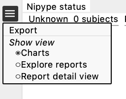
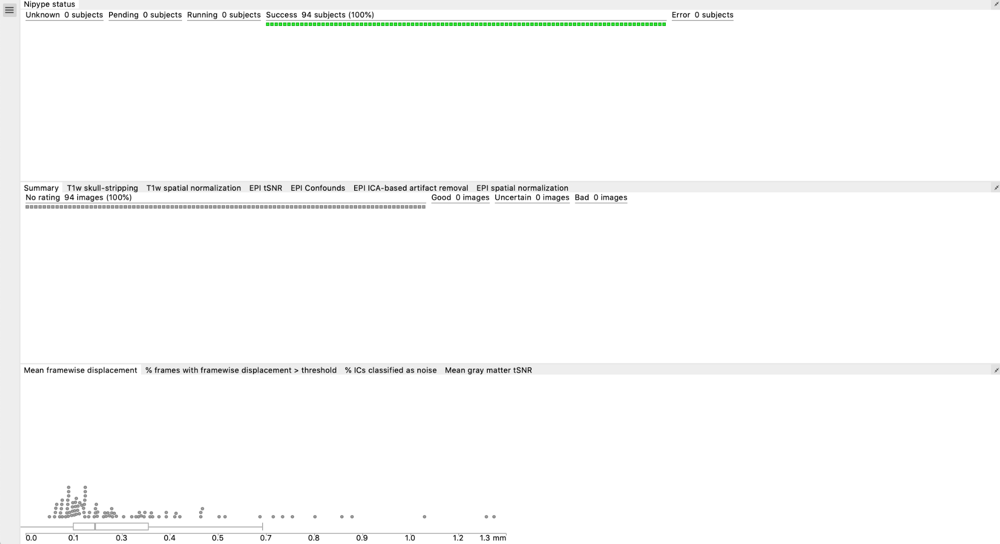
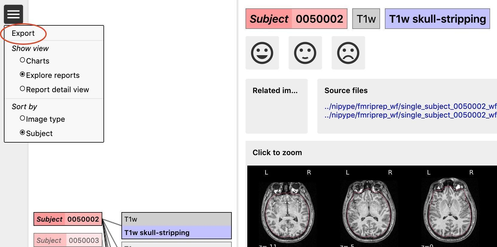

[Quality control](../quality-control.qmd) · [Cheat Sheet](cheat-sheet.qmd)

<!-- qc-source-start -->
Open the **index.html** file in the reports folder in your favourite browser. You can navigate through different windows by clicking on the drop-down menu (the three lines in the top left corner next to Nypipe status, see image below): **charts, explore reports and report detail view**.

::: {.callout-tip collapse="false"}

As you make them, the ratings are saved in the browser's local storage, and they will stay there unless you delete the `cookies/site` data. To review the ratings you made, open the index.html file from the same local machine using the same browser.

:::

## Charts {#charts}

This is divided in 3 sections:

- Nipype status (pending, success, error)
- Summary and ratings for each feature (summary, T1w skull-stripping, T1w spatial normalization, EPI tSNR, EPI Confounds, EPI ICA, EPI spatial normalization)
- Group plots for Mean FD, % of frames with FD>0.5, % IC classified as noise, mean GM tSNR → each dot is a subject, if you click on a dot it will take you to their QC page

## Explore reports {#explore-reports}

The reports contain images for each participant for the following pre-processing steps:
1. T1w skull stripping and segmentation
2. T1w spatial normalisation
3. EPI tSNR
4. EPI confounds (carpet plot)
5. EPI ICA-based artefact removal
6. EPI spatial normalisationƒ

**Each pre-processing step should be rated for each participant (good, uncertain, bad)** using the emoticons. You can zoom in by clicking on the report (or clicking on 'report detail view' from the dropdown menu). All images/subjects should be rated (i.e., either good, uncertain, or bad), in order to have a comprehensive QA from each site.

Instead of using the mouse clicks to rate the images, you can also use the following keyboard acuts: [w] rates image as good, [s] as uncertain and [x] as bad. The keys [d] and [a] jump to the next, respectively the previous image.

After rating the images (see below for the explanation), the rating should be exported by going to the menu (the icon in the upper left corner, see example) of the reports page, and then clicking **"Export"**. They will be saved as ‘exclude.json’. The ratings are also displayed in the summary and ratings for each feature chart. If ratings do not get exported, there's a risk of losing your progress once you delete your cookies.

You can switch between sort **'per image type'** or **'per subject'**. Sorting the reports per image type (e.g., by skull stripping reports) will help you get a sense of how each image looks like across all subjects and will give you an idea of wwhat a 'normal' image looks like and what stands out.

Sorting per subject will allow you to check how the same subject performed across the different pre-processing steps. We recommend sorting per image type, because that gives you an idea of what a good or bad image looks like. However, if you are unsure about the quality of a certain subject in one step, switch to sorting per subject to see how the same subject performed across the different steps (this could be useful to determine if they need to be excluded).

Below we report examples of each pre-processing step, how they should look like, what to look for to identify errors and when to exclude a participant.

::: {.callout-important collapse="false"}

If you rate a subject as **'bad'*** in one of the images, it will later automatically be excluded from the group analysis.

Obvious issues (e.g., large portion of the brain missing after skull stripping, poor T1 or EPI normalisation, very clear artefacts in the EPI showing in the tSNR) are usually worth the exclusion of the subject (or you can try to re-run the subject if the problem is for example skull stripping).

Usually, bad examples of skull stripping, registration etc are the results of a problematic subject (e.g., lot of motion, not enough WM/GM contrast, signal loss, etc), so it is helpful to check all the reports for that subject, especially if you are unsure, before deciding to exclude them.

The carpet plot and the ICA AROMA report can be hard to interpret on their own and (especially if you are unsure about the result) **we recommend examining them in conjunction with the other images.**

:::
<!-- qc-source-end -->
