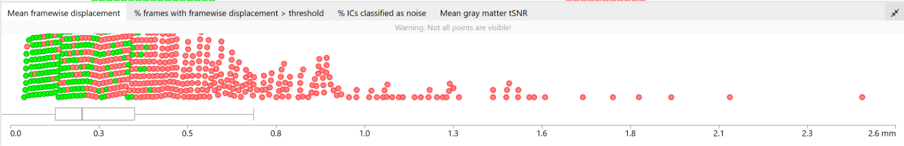

[Quality control](../quality-control.qmd) · [Cheat Sheet](cheat-sheet.qmd)

<!-- qc-source-start -->
If a subject is rated as ‘bad’ in one of the functional QC steps, it will be excluded. You can try to rerun these subjects.

If you do not have to exclude or rerun any participants, continue to step 3.

If you have to exclude participants: rerun these participants following the [steps in 1.1.1](summary-report.qmd#step-1.1.1-re-run-missing-or-failed-subjects)

If you have already tried to rerun the excluded participants, but they still did not pass the QC, exclude them from your output and continue to step 3.

After finishing the QC, it makes sense to check if all of the “outliers” (which show high mean framewise displacement) are excluded. If they aren't, it makes sense to check again.

Once you have finished the QC, click on the three horizontal stripes on the left (to open the menu), and select ‘Export’ (see page 4). An exclude.json file with the ratings will now be created.

<!-- qc-source-end -->
