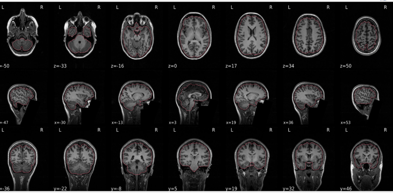
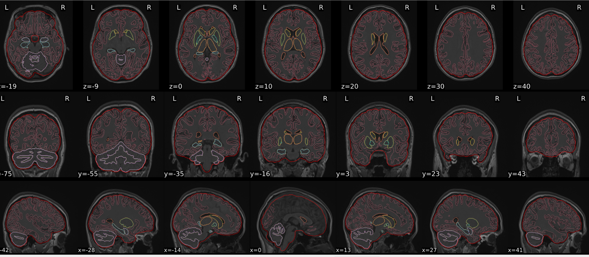
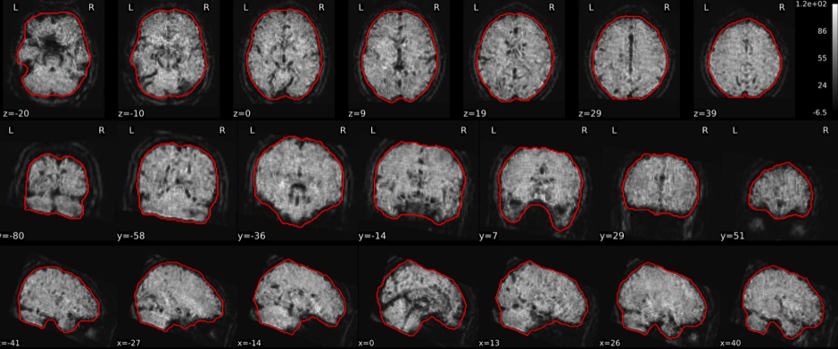
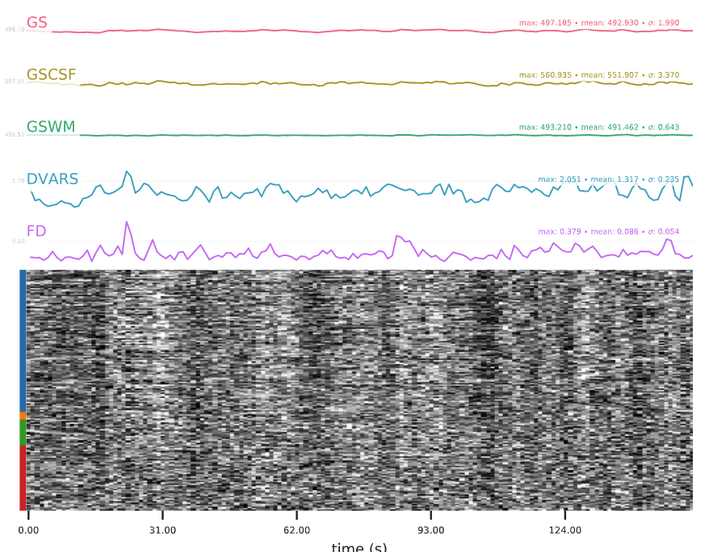
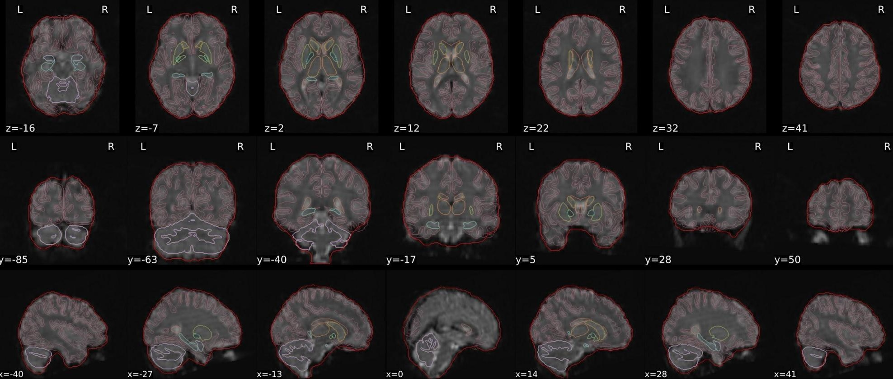

::: {.qc-page-tools}
[Rating instructions](reports.qmd#explore-reports){.btn .btn-outline-secondary .btn-sm}
[Cheat Sheet](cheat-sheet.qmd){.btn .btn-outline-secondary .btn-sm}
:::

In your HALFpipe report, open **Explore reports** and sort by image type. Choose the matching report type below to see what to look for and compare examples as you rate. If you're unsure about an image, switch to sorting by subject and check that participant's other reports.

## Examples by report type {#examples-by-report-type}

Review the report types your run produced.

::: {.qc-category-grid}

::: {.qc-nav-card}
[T1w skull stripping](skull-stripping.qmd){.qc-card-title}

[{.qc-card-image .nolightbox}](skull-stripping.qmd)
:::

::: {.qc-nav-card}
[dT1w spatial normalisation](t1w-normalisation.qmd){.qc-card-title}

[{.qc-card-image .nolightbox}](t1w-normalisation.qmd)
:::

::: {.qc-nav-card}
[EPI tSNR](tsnr.qmd){.qc-card-title}

[{.qc-card-image .nolightbox}](tsnr.qmd)
:::

::: {.qc-nav-card}
[EPI confounds (carpet plot)](confounds.qmd){.qc-card-title}

[{.qc-card-image .nolightbox}](confounds.qmd)
:::

::: {.qc-nav-card}
[EPI spatial normalisation](epi-normalisation.qmd){.qc-card-title}

[{.qc-card-image .nolightbox}](epi-normalisation.qmd)
:::

:::

When you've finished rating, [review any reruns and export your ratings](rerun.qmd).

## Optional ICA-AROMA examples {#optional-ica-aroma}

The five denoising pipelines in the current ENIGMA resting-state workflow do not use ICA-AROMA. HALFpipe can still generate this panel for QC. See the [ICA-AROMA examples](ica.qmd) if you need to interpret it.
