::: {.qc-page-tools}
[Quality control](../quality-control.qmd){.btn .btn-outline-secondary .btn-sm}
[Cheat Sheet](cheat-sheet.qmd){.btn .btn-outline-secondary .btn-sm}
[Examples](#example-of-a-good-subject){.btn .btn-outline-secondary .btn-sm}
[Summary](#summary){.btn .btn-outline-secondary .btn-sm}
:::

<!-- qc-source-start -->
Skull stripping is the process separating the brain (cortex and cerebellum) from the skull. The red line follows the outline of the brain and it separates it from the skull.

## **Example of a good subject**  {#example-of-a-good-subject}

- There are no skull stripping errors, such as portions of the brain missing, or too much of the skull retained
- The red line follows the outline of the brain

Examples (12)

::: {.qc-example-gallery}

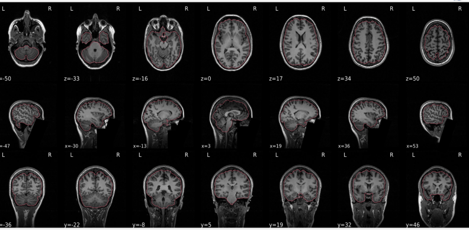{group="good-skull-stripping" width=1200}

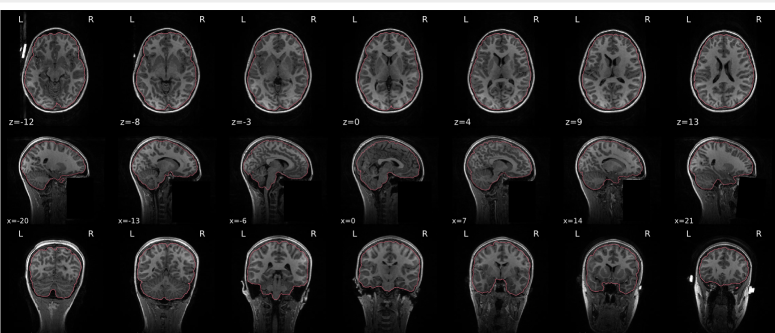{group="good-skull-stripping" width=1200}

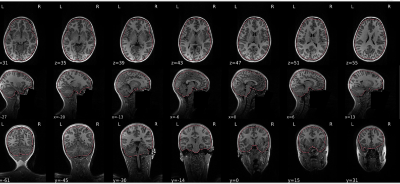{group="good-skull-stripping" width=1200}

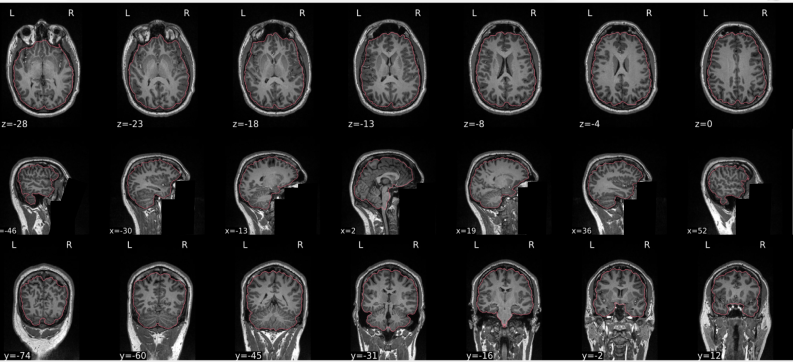{group="good-skull-stripping" width=1200}

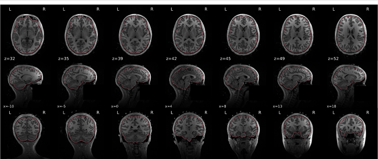{group="good-skull-stripping" width=1200}

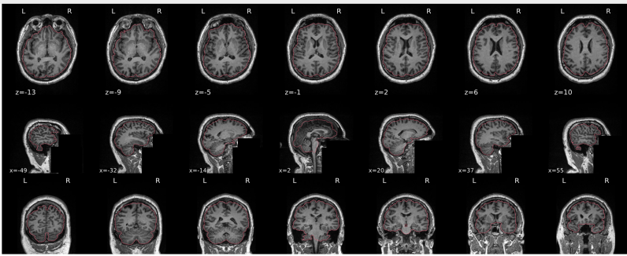{group="good-skull-stripping" width=1200}

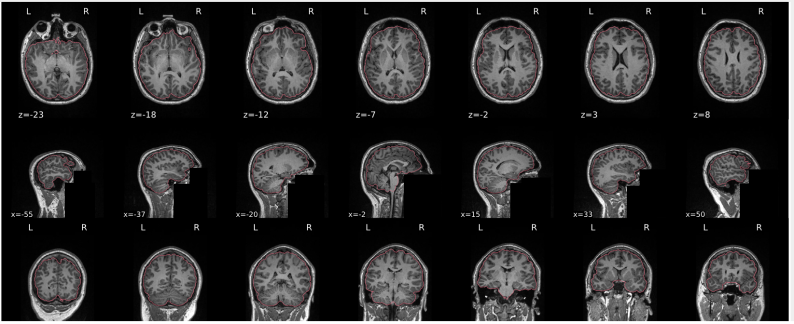{group="good-skull-stripping" width=1200}

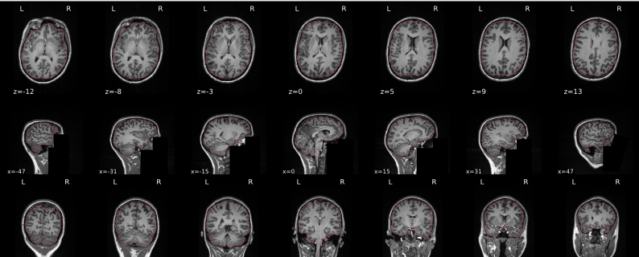{group="good-skull-stripping" width=1200}

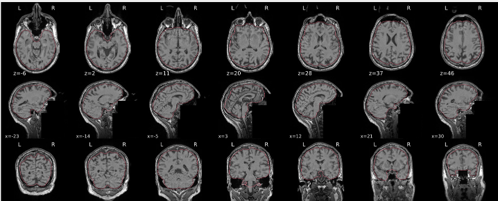{group="good-skull-stripping" width=1200}

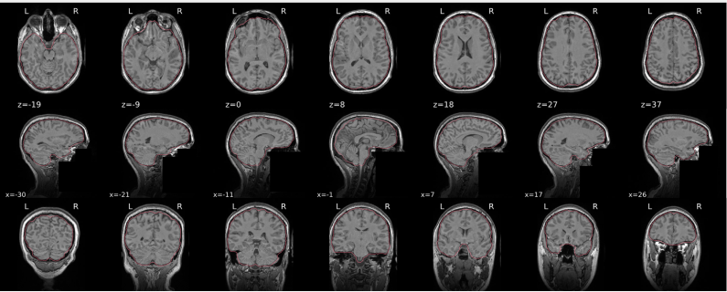{group="good-skull-stripping" width=1200}

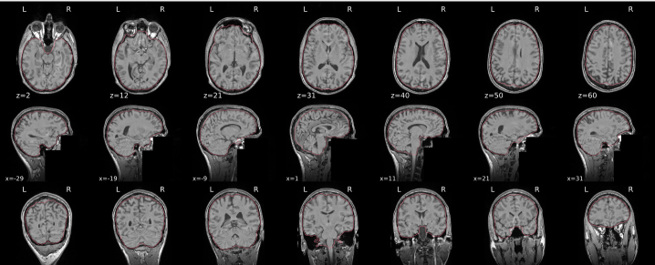{group="good-skull-stripping" width=1200}

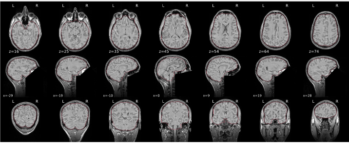{group="good-skull-stripping" width=1200}

:::

## **Example of a bad subject**  {#example-of-a-bad-subject}

- There are skull stripping errors, such as portions of the brain missing, or too much of the skull retained
- **NOTE:** check all the images (slices) in the report. If only one image (slice) looks problematic, it is possible that the subject is okay and it is just a visual issue in that particular screenshot

Examples (9)

::: {.qc-example-gallery}

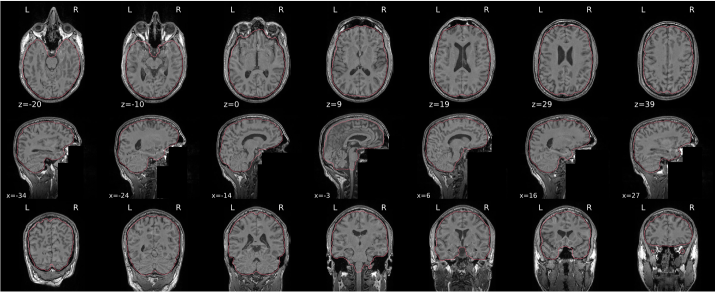{group="bad-skull-stripping" width=1200}

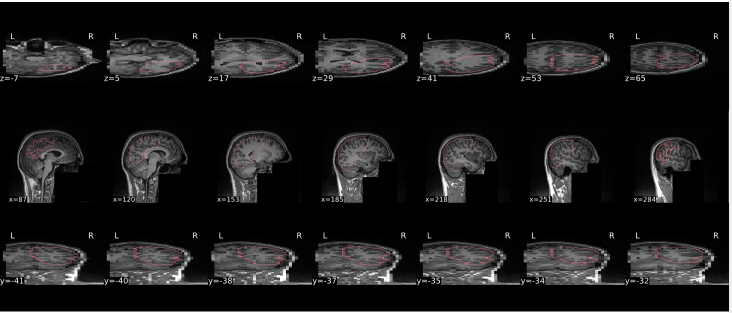{group="bad-skull-stripping" width=1200}

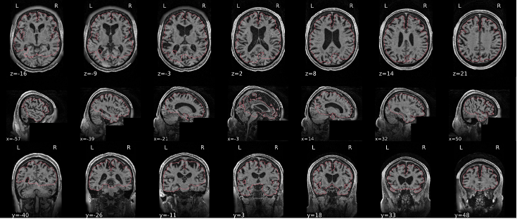{group="bad-skull-stripping" width=1200}

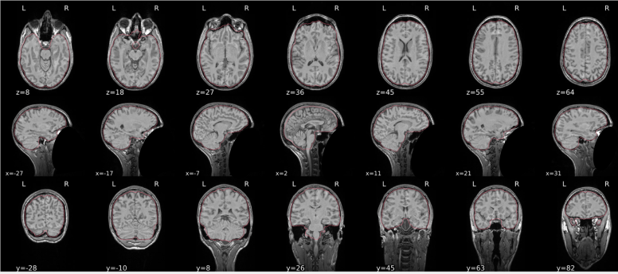{group="bad-skull-stripping" width=1200}

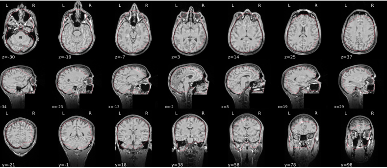{group="bad-skull-stripping" width=1200}

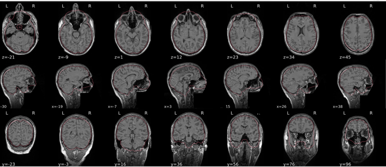{group="bad-skull-stripping" width=1200}

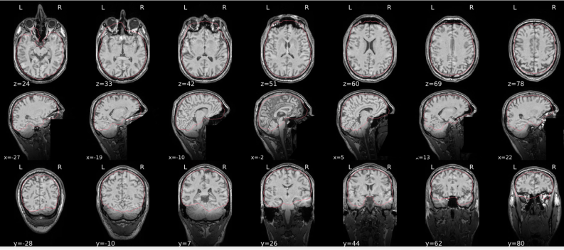{group="bad-skull-stripping" width=1200}

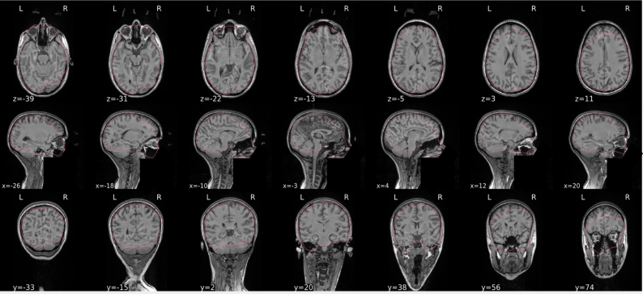{group="bad-skull-stripping" width=1200}

{group="bad-skull-stripping" width=1200}

:::

## **Summary** {#summary}

| **Good** | **Bad** |
|:---|:---|
| The brain is fully inside the red line | Structures like the cranium or the eyes are inside the red line |
| No important brain structures are outside of the red line red line follows the natural outline of the brain | Important brain structures are missing inside of the red line |
: Table summary for skull stripping {.striped .hover}

:::{.callout-note collapse="false"}
 -> if only one slice is problematic, it could be an issue related to the visual depiction of the data instead of an issue related to the test subject
:::
<!-- qc-source-end -->
