[Quality control](../quality-control.qmd) · [Cheat Sheet](cheat-sheet.qmd) · [Examples](#example-of-a-good-subject-2) · [Summary](#summary-2)

<!-- qc-source-start -->
In the signal to noise ratio images of the resting state image the desired signal is compared to the amount of background noise. It is important to check all the views (sagittal, coronal, axial) because some artefacts (e.g., stripes) may be evident only in one particular view.

## **Example of a good subject**  {#example-of-a-good-subject-2}

- Signal to noise is symmetrically distributed and there is no signal distortion

::: {.callout-note collapse="true" icon="false" title="EPI tSNR: Example of a good subject"}

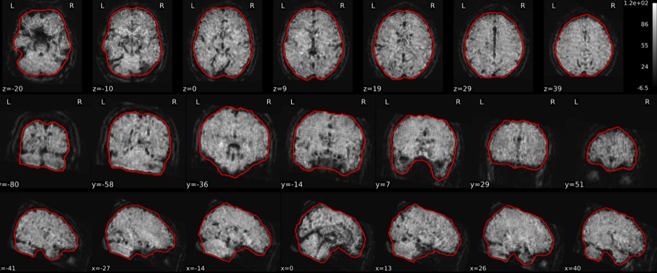{group="good-epi_tsnr"}

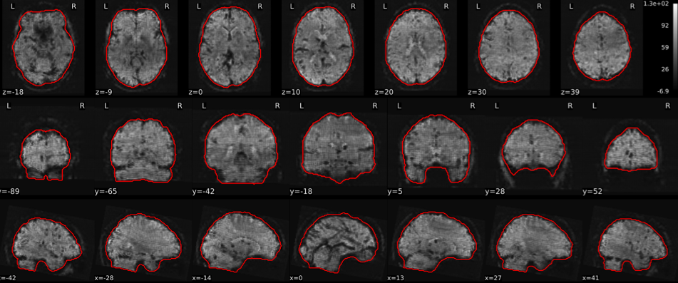{group="good-epi_tsnr"}

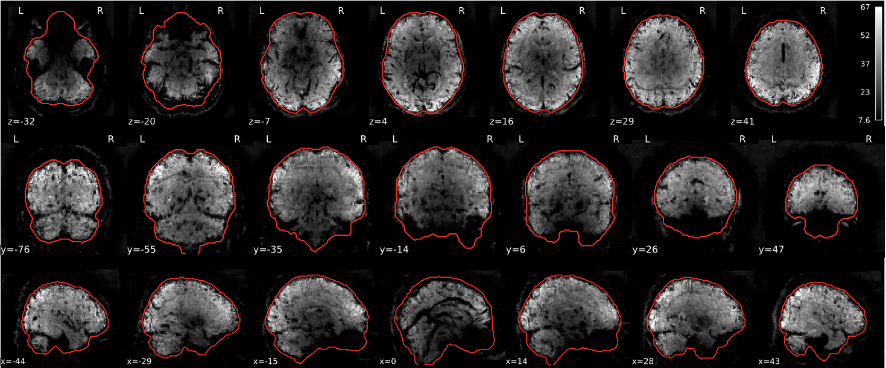{group="good-epi_tsnr"}

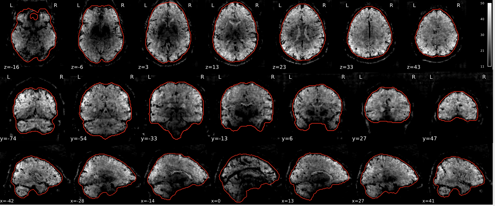{group="good-epi_tsnr"}

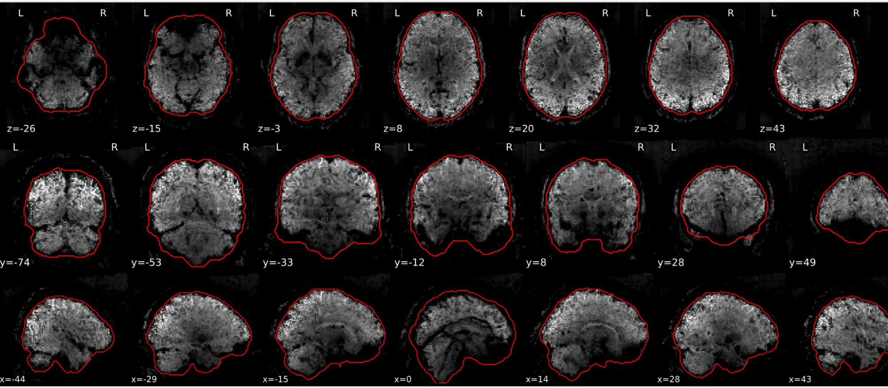{group="good-epi_tsnr"}

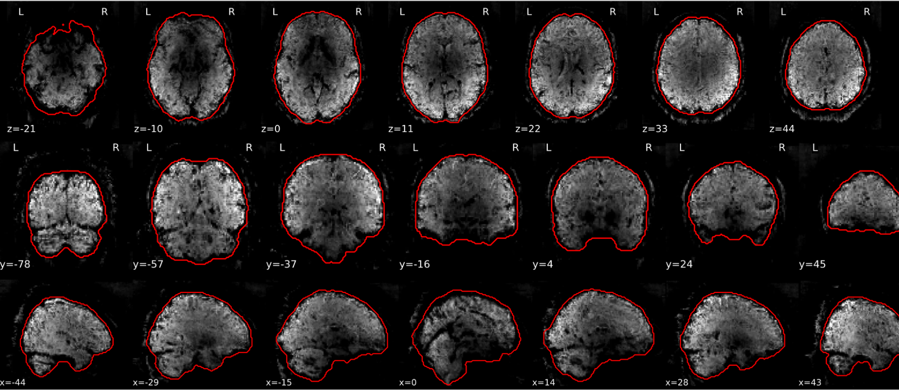{group="good-epi_tsnr"}

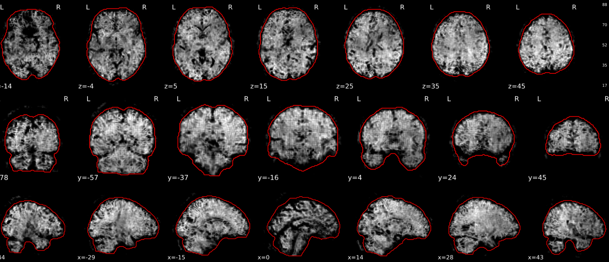{group="good-epi_tsnr"}

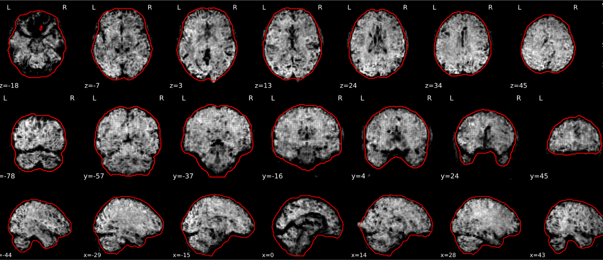{group="good-epi_tsnr"}

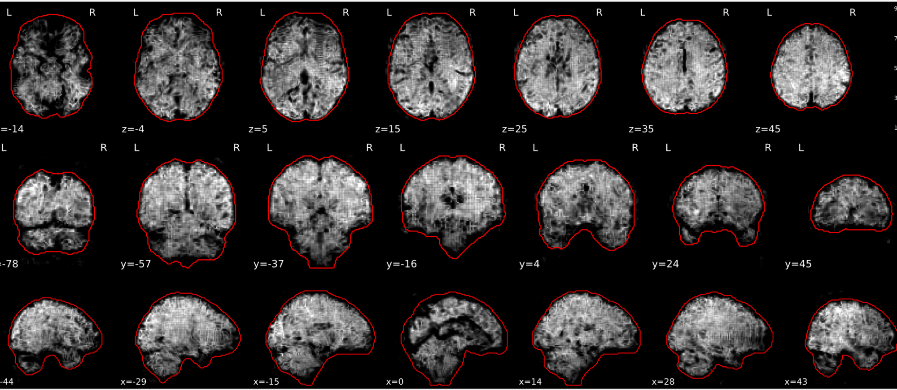{group="good-epi_tsnr"}

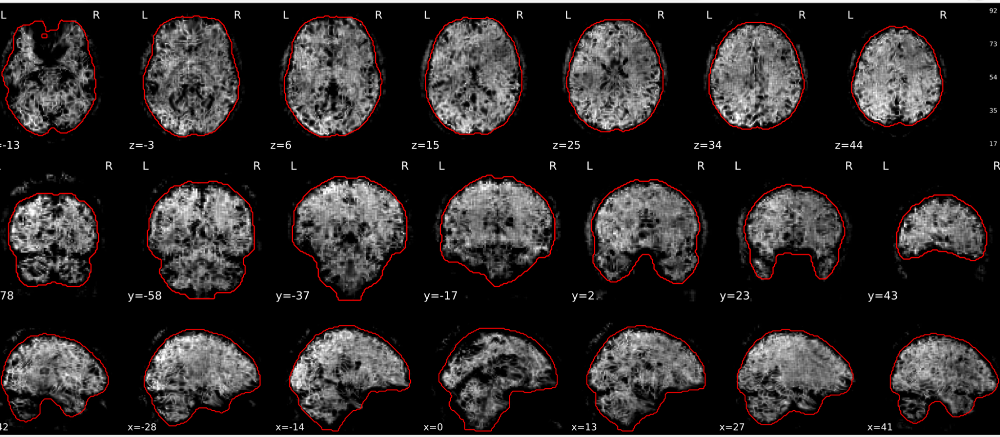{group="good-epi_tsnr"}

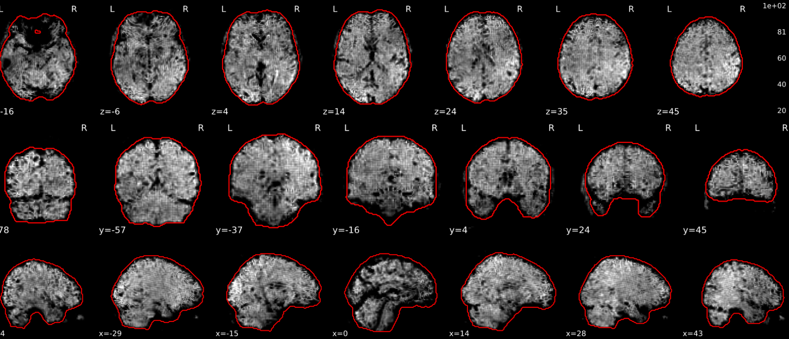{group="good-epi_tsnr"}

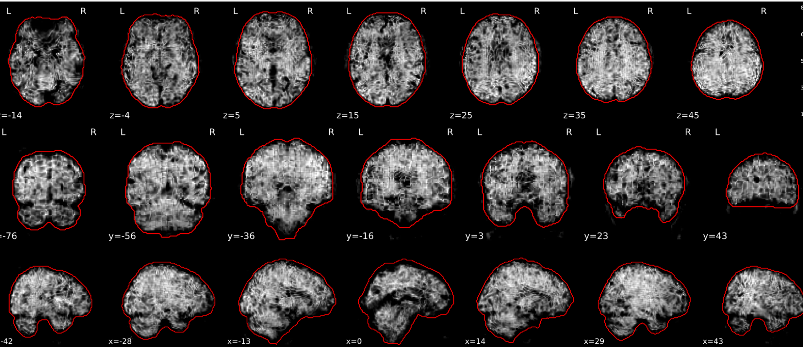{group="good-epi_tsnr"}

:::

## **Example of a bad subject**  {#example-of-a-bad-subject-2}

- Asymmetry
- Potential signal distortion (might represent an artefact)
- Signal drop-out
- Stripes artefact

::: {.callout-note collapse="false"}
Clear large artefact (e.g., zebra stripes in example 1) are worth the exclusion of the subject. If you are unsure, *check the other quality metrics for that subject to decide whether they should be excluded*.
:::

::: {.callout-note collapse="true" icon="false" title="EPI tSNR: Example of a bad subject"}

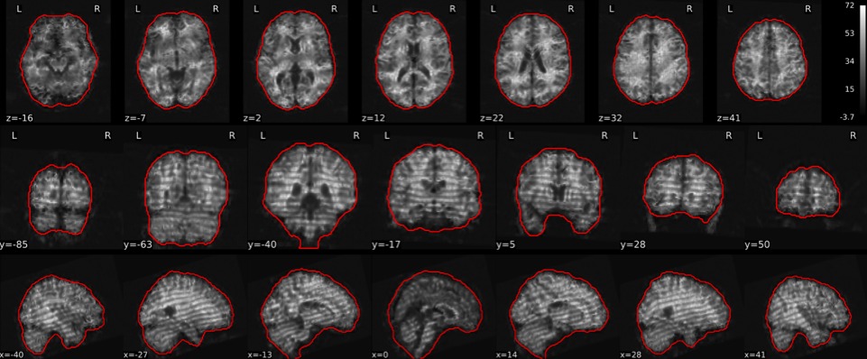{group="bad-epi_tsnr"}

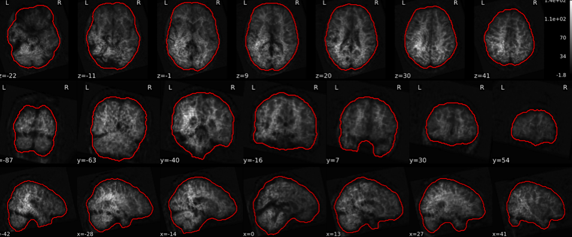{group="bad-epi_tsnr"}

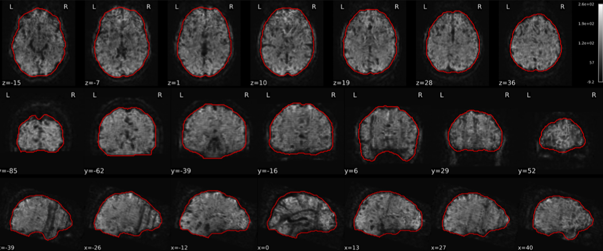{group="bad-epi_tsnr"}

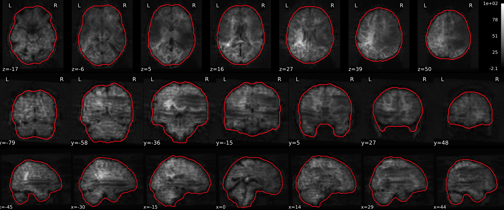{group="bad-epi_tsnr"}

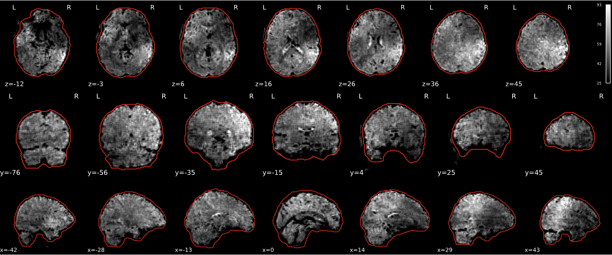{group="bad-epi_tsnr"}

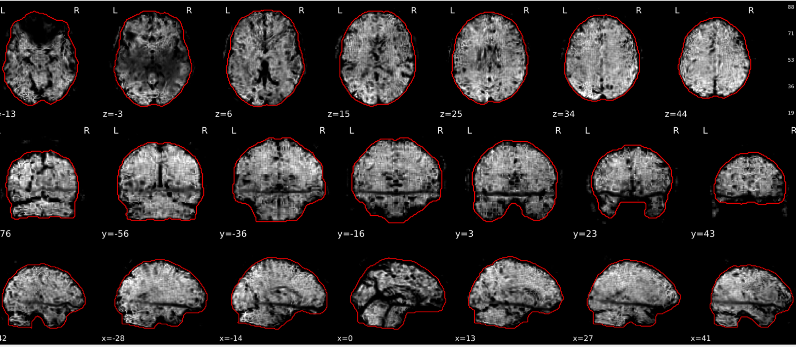{group="bad-epi_tsnr"}

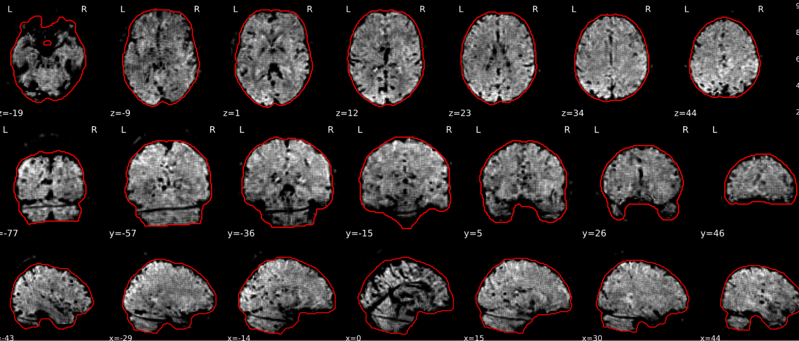{group="bad-epi_tsnr"}

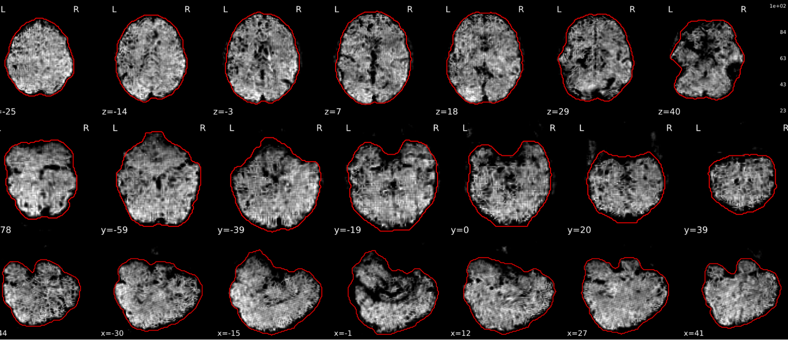{group="bad-epi_tsnr"}

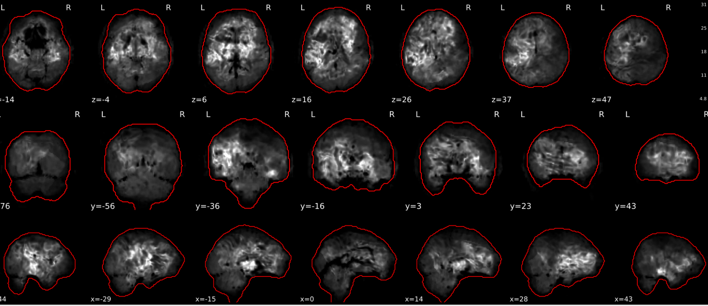{group="bad-epi_tsnr"}

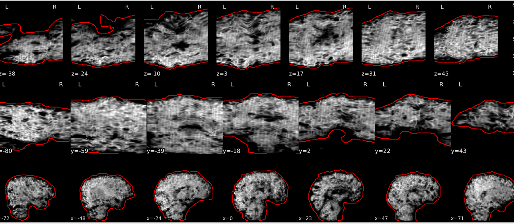{group="bad-epi_tsnr"}

:::

## **Summary** {#summary-2}

| **good** | **bad** |
|---|---|
| Symmetrical distribution of noise and signal | Asymmetry |
| No disruptions of the signal  (no “black patches”) | Potential signal disruptions  (could be related to artefacts) |
| No stripes  (sign of high motion) | Signal drop |
|  | Stripe artefacts  (“zebra” stripes due to motion) |
: Table summary for EPI tSNR {.striped .hover}
<!-- qc-source-end -->
