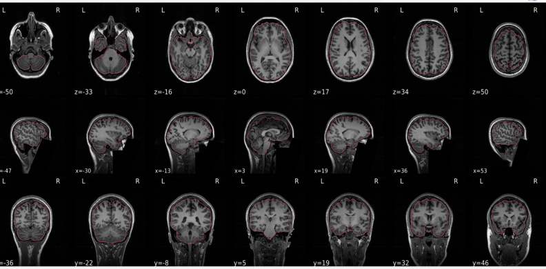
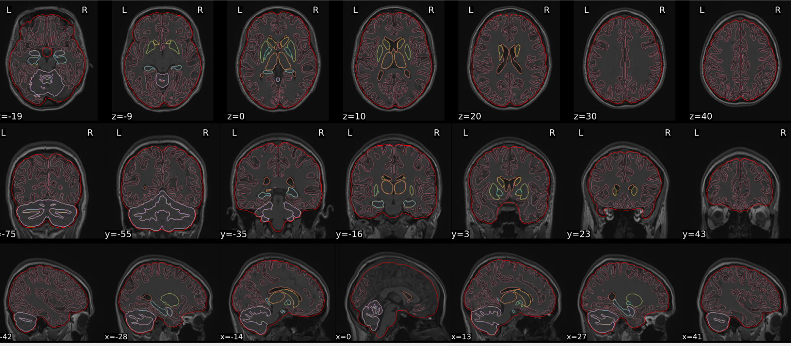
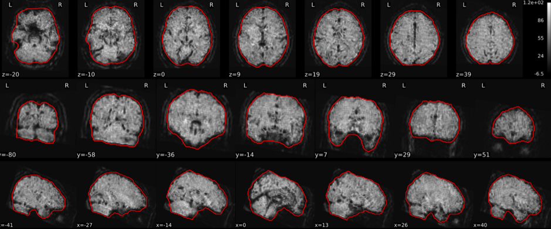
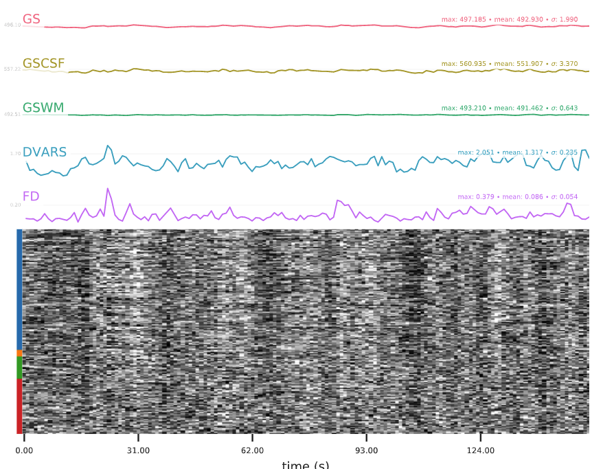
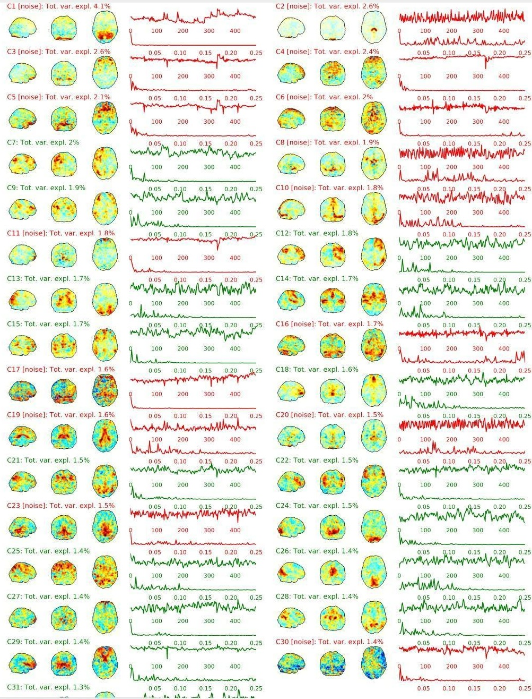
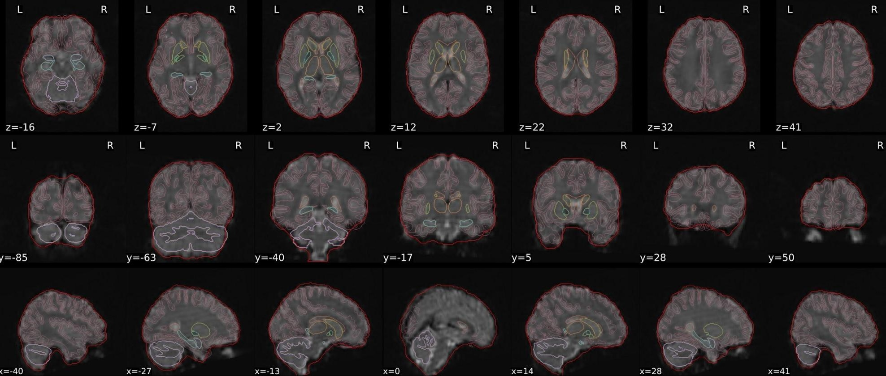

If the pipeline is still running or expected outputs are missing, see [3. Run and check outputs](check_run.qmd) to check completion and rerun failed subjects. If the expected outputs are present, start the QC review below.

[Before starting the QC](qc/before-starting.qmd){.btn .btn-primary}
[Cheat Sheet](qc/cheat-sheet.qmd){.btn .btn-outline-primary}

## Workflow

::: {.qc-workflow-grid}

::: {.qc-nav-card}
[Before starting the QC](qc/before-starting.qmd){.qc-card-title}
:::

::: {.qc-nav-card}
[Step 1: Open the summary report in the reports folder](qc/summary-report.qmd){.qc-card-title}
:::

::: {.qc-nav-card}
[Step 2: Open the index.html page](qc/reports.qmd){.qc-card-title}
:::

::: {.qc-nav-card}
[4.6 Rerun subjects if needed](qc/rerun.qmd){.qc-card-title}
:::

:::

## QC categories

::: {.qc-category-grid}

::: {.qc-nav-card}
[T1w skull stripping](qc/skull-stripping.qmd){.qc-card-title}

[{.qc-card-image .nolightbox}](qc/skull-stripping.qmd)
:::

::: {.qc-nav-card}
[dT1w spatial normalisation](qc/t1w-normalisation.qmd){.qc-card-title}

[{.qc-card-image .nolightbox}](qc/t1w-normalisation.qmd)
:::

::: {.qc-nav-card}
[EPI tSNR](qc/tsnr.qmd){.qc-card-title}

[{.qc-card-image .nolightbox}](qc/tsnr.qmd)
:::

::: {.qc-nav-card}
[EPI confounds (carpet plot)](qc/confounds.qmd){.qc-card-title}

[{.qc-card-image .nolightbox}](qc/confounds.qmd)
:::

::: {.qc-nav-card}
[EPI ICA-based artefact removal](qc/ica.qmd){.qc-card-title}

[{.qc-card-image .nolightbox}](qc/ica.qmd)
:::

::: {.qc-nav-card}
[EPI spatial normalisation](qc/epi-normalisation.qmd){.qc-card-title}

[{.qc-card-image .nolightbox}](qc/epi-normalisation.qmd)
:::

:::

About this manual

::: {.author-text}
 AUTHOR

Written by Lina Mograby.

Previous version by Elena Pozzi, Yara Toenders, Ilya Veer, Lea Waller, Courtney Haswell, Rajendra Morey, and Lianne Schmaal

Please address questions and comments to [halfpipe@fmri.science](mailto:halfpipe@fmri.science). You can also join the HALFpipe Mattermost (similar to Slack) using this [link](https://mattermost.fmri.science/signup_user_complete/?id=hcc766b7wjdazexwe799hbsuwc&md=link&sbr=su).
:::

